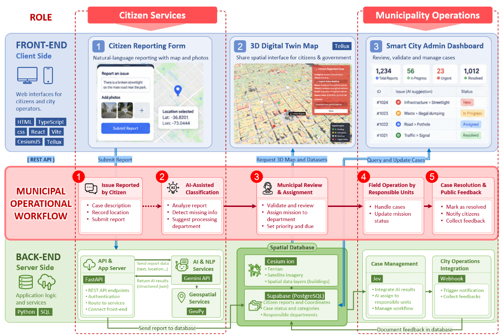

<div align="center">

# Concepcion Smart City

Smart reporting and city operations in one dashboard.

[](https://react.dev/)
[](https://vitejs.dev/)
[](https://www.typescriptlang.org/)
[](https://fastapi.tiangolo.com/)
[](https://supabase.com/)

[**Overview**](#why-this-project) · [**Features**](#features) · [**Setup**](#quick-start) · [**Deploy**](#deployment)

</div>

<!-- <p align="center">
  
</p> -->

---

Concepcion Smart City is a civic technology prototype that helps residents report infrastructure and public service issues while giving local authorities a centralized, map-based operational view of the city.

The project combines a citizen issue submission flow with a municipal dashboard, enabling faster response times and more transparent communication between the public and city agencies.

## Why this project

Cities increasingly need tools that make public reporting simple, visible, and actionable. This application demonstrates a practical smart-city approach to:

- collecting location-based community issues
- improving public service responsiveness
- enabling municipal review and triage workflows
- visualizing city operations through a 3D digital-twin experience

## Architecture

The repository is split into two independently installable and deployable applications:

- `frontend/` — React, TypeScript, and Vite. It serves the web application and currently connects to Supabase for report data.
- `backend/` — FastAPI service for the citizen assistant, classification, and geocoding.

Each application owns its dependencies and environment configuration. The frontend calls the backend through `VITE_BACKEND_URL`; the backend allows configured browser origins through `BACKEND_CORS_ORIGINS`. Supabase remains the frontend's current report-data provider and can be migrated behind the API separately when needed.



## Quick Start

### Prerequisites

- Node.js 18+
- npm
- Python 3.10+
- Supabase project access
- Cesium ion token (recommended for photorealistic map layers)

### 1) Configure and start the frontend

```powershell
cd frontend
npm ci
if (!(Test-Path .env)) { Copy-Item .env.example .env }
npm run dev
```

Set the Supabase URL and anon key in `frontend/.env`, and add a Cesium ion token if using Cesium-backed layers. The backend URL defaults to the local FastAPI service.

If you previously used a repository-root `.env`, move its `VITE_*` values to `frontend/.env` and its `GEMINI_API_KEY` / `BACKEND_CORS_ORIGINS` values to `backend/.env`. Keep both files untracked.

### 2) Configure and start the backend

```powershell
cd backend
python -m venv .venv
.\.venv\Scripts\Activate.ps1
pip install -r requirements.txt
if (!(Test-Path .env)) { Copy-Item .env.example .env }
uvicorn app.main:app --reload
```

Set `GEMINI_API_KEY` in `backend/.env`. Run the frontend and backend in separate terminals.

## Supabase authentication and municipal access

The frontend uses Supabase Auth for citizen and municipal accounts. New users can register immediately. A newly registered municipal account receives read-only sample data; it cannot query real reports or update/delete records. Real municipal access is granted only by setting trusted `app_metadata` from the Supabase dashboard/SQL Editor. The role a user requests during signup is stored as untrusted user metadata and never grants privileges.

### Supabase project setup

1. In **Authentication → Sign In / Providers → Email**, enable email/password sign-in and user signups. To allow signup to create an active session immediately, turn off **Confirm email**. This means the app does not verify email ownership; use a password reset/verification flow or enable confirmations with a custom SMTP provider before production use.
2. In **Authentication → URL Configuration**, add your local frontend URL (for example `http://localhost:5173/**`) and deployed frontend URL (for example `https://peichitsai.github.io/Concepcion-Smart-City-Digital-Twin/**`) to the allowed redirect URLs.
3. Apply `supabase/migrations/20261021000000_auth_and_report_access.sql` in the Supabase SQL Editor. It adds report ownership, enables RLS, removes existing `reports` policies, and installs policies allowing account owners to read their own reports and approved municipal accounts to manage all reports. Anonymous access to `reports` is revoked. Review existing `reports` policies before applying, because this migration intentionally replaces them.
4. Put the project's URL and anon/publishable key in `frontend/.env` as `VITE_SUPABASE_URL` and `VITE_SUPABASE_ANON_KEY`. Add the same project URL and anon key to `backend/.env` as `SUPABASE_URL` and `SUPABASE_ANON_KEY` so FastAPI can verify user sessions. Never put a service-role/secret key in either frontend or backend app configuration.

### Request municipal access

After signing into **City operations** in read-only demo mode, submit the access request form with your organization and reason. The signed-in account email is stored automatically from Supabase Auth; users cannot choose or spoof this value. Requests are private to the submitting account and do not grant access.

Apply `supabase/migrations/20261021220000_municipal_access_requests.sql` in the Supabase SQL Editor. It creates the request table or updates an existing one with the email column, and can be safely re-run.

Review pending requests in the SQL Editor:

```sql
select
  r.email,
  u.raw_user_meta_data ->> 'full_name' as full_name,
  r.organization,
  r.reason,
  r.requested_at
from public.municipal_access_requests as r
join auth.users as u on u.id = r.user_id
where u.raw_app_meta_data ->> 'municipal_approved' is distinct from 'true'
order by r.requested_at;
```

### Approve a municipal account

After reviewing the request and verifying the account, run this in the Supabase SQL Editor, replacing the email with the approved account:

```sql
update auth.users
set raw_app_meta_data =
  coalesce(raw_app_meta_data, '{}'::jsonb)
  || '{"role":"municipal_admin","municipal_approved":true}'::jsonb
where email = 'approved.staff@example.gov';
```

The user must sign out and sign back in to receive a token with the updated role. Only trusted administrators should run this approval query. Do not grant roles by updating `raw_user_meta_data`, which users can change themselves.

Supabase Free includes a limited database, storage, egress, and email allowance; check the current [Supabase pricing](https://supabase.com/pricing) and [Auth rate limits](https://supabase.com/docs/guides/auth/rate-limits). AI requests also consume the separate Gemini/API hosting quotas. Disabling email confirmation reduces email use but does not prevent account abuse; monitor quotas and add rate limits before opening a public production service.

## Features

- Citizens can submit issue reports with contact details and descriptions
- Map-based location selection for precise geospatial reporting
- Category-based classification for urban issues
- Urgent escalation option for police-sensitive incidents
- 3D city dashboard for municipal monitoring
- Admin dashboard for reviewing, updating, and deleting reports
- Supabase-powered data persistence and status tracking

## Deployment

Deploy the frontend and backend independently. Frontend commands run from `frontend/` and publish `frontend/dist`; the FastAPI application runs from `backend/`. Configure each service using its own environment variables. The frontend's `VITE_BASE_PATH` defaults to `/`; GitHub Pages sets the repository subpath in its workflow.

### Vercel

1. Push the project to GitHub.
2. Import the repository in Vercel and set the project root to `frontend`.
3. Add the following environment variables:
   - `VITE_SUPABASE_URL`
   - `VITE_SUPABASE_ANON_KEY`
   - `VITE_CESIUM_ION_TOKEN`
   - `VITE_BACKEND_URL`
4. Deploy the app.

### Netlify

1. Connect the repository to Netlify.
2. Set the base directory to `frontend` and the build command to:

```bash
npm run build
```

3. Set the publish directory to:

```bash
dist
```

4. Add `VITE_SUPABASE_URL`, `VITE_SUPABASE_ANON_KEY`, `VITE_CESIUM_ION_TOKEN`, and `VITE_BACKEND_URL` in Netlify project settings.

### Static hosting

The frontend can also be deployed to any static hosting provider that supports Vite builds. Configure `VITE_BASE_PATH` for the deployment path and `VITE_BACKEND_URL` for the deployed API URL.

### GitHub Pages frontend and Render backend

GitHub Pages hosts only the frontend. Deploy the FastAPI service separately to Render:

1. Create a Render Web Service connected to this repository's `main` branch.
2. Set **Root Directory** to `backend`, **Build Command** to `pip install -r requirements.txt`, and **Start Command** to `uvicorn app.main:app --host 0.0.0.0 --port $PORT`.
3. Add `GEMINI_API_KEY` to the Render service's environment variables. Set `BACKEND_CORS_ORIGINS` to `http://localhost:5173,https://peichitsai.github.io`.
4. After Render deploys, copy the service URL (for example, `https://your-service.onrender.com`).
5. In GitHub, open **Settings → Secrets and variables → Actions → Variables** and create a repository variable named `VITE_BACKEND_URL` with the Render service URL. This URL is public and should be an Actions variable, not a secret.
6. Push to `main` or manually rerun the GitHub Pages workflow. The frontend build uses `VITE_BACKEND_URL` to call the API.

## Project structure

```text
.
├── frontend/
│   ├── public/
│   ├── src/
│   ├── .env.example
│   ├── package.json
│   ├── package-lock.json
│   └── vite.config.ts
├── backend/
│   ├── app/
│   ├── data/
│   ├── .env.example
│   └── requirements.txt
├── .github/
│   └── workflows/
├── README.md
└── .gitignore
```

## Supabase setup

The app expects a `reports` table with fields such as:

- `id`
- `name`
- `phone`
- `email`
- `category`
- `is_urgent_police`
- `text`
- `lat`
- `lon`
- `status`
- `time`

Adjust the schema to suit your municipality’s operational needs and data privacy policy.

## Tech stack

- React 19
- TypeScript
- Vite
- FastAPI
- Python
- React Router
- Supabase
- Cesium / Tellux-style 3D visualization
- Three.js ecosystem

## How it works

1. A resident submits a city issue through the citizen portal.
2. The report includes the issue details and selected location.
3. The data is stored in Supabase.
4. Government staff review and update report status in the admin panel.
5. City teams can act on issues more efficiently using the 3D dashboard view.

## Notes

- The app uses browser alerts for interactive feedback during report submission.
- Missing environment variables can prevent Supabase connectivity and map features from working correctly.
- Map rendering quality depends on your Cesium token and service configuration.

## License

This project is licensed under the ISC license as defined in the package metadata.

---

<p align="center">
  <strong>Built for smarter public services and more responsive city operations.</strong>
</p>
